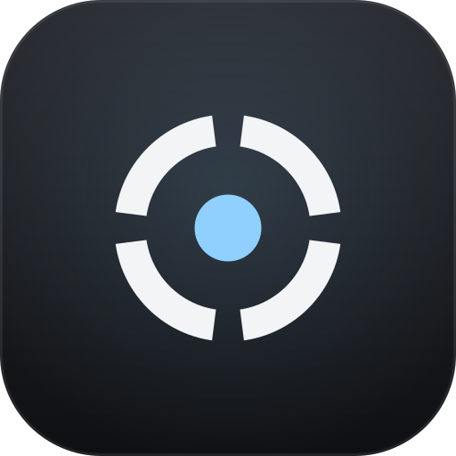
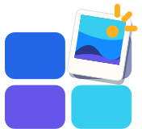
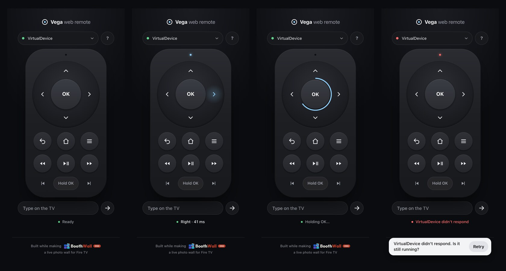
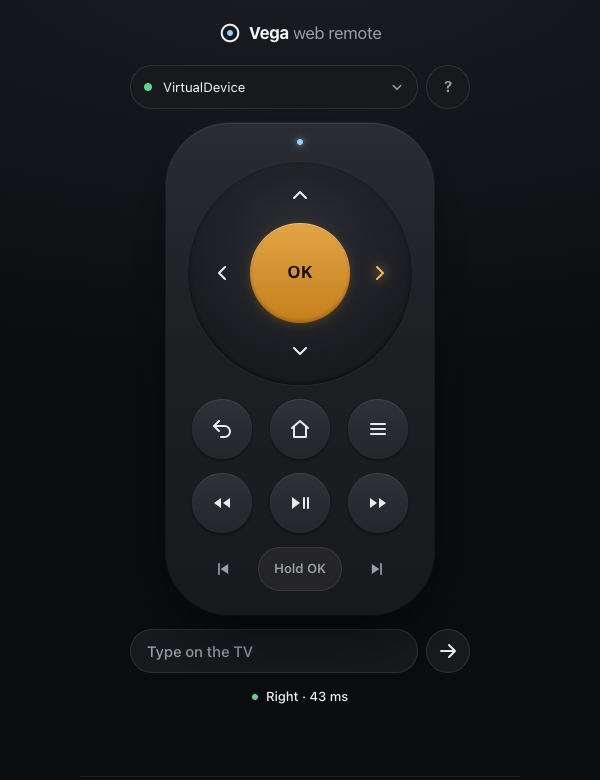
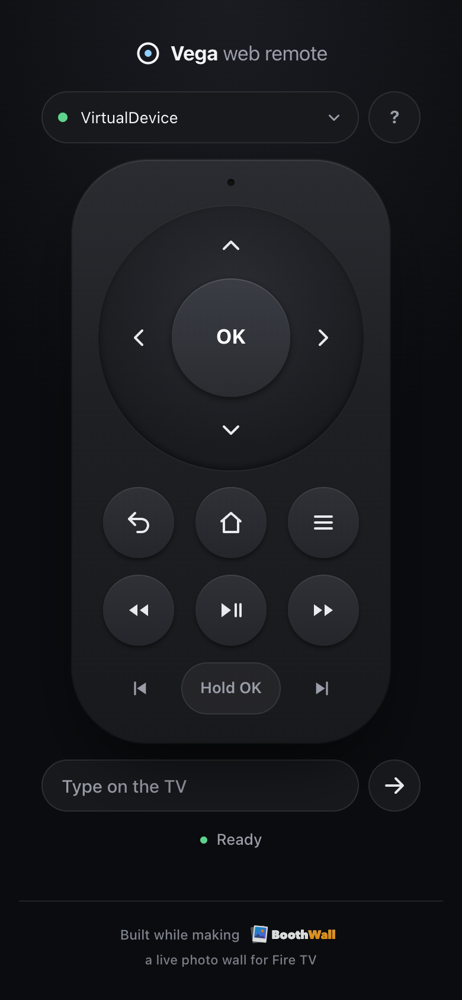

<p align="center"></p>
<h1 align="center">Vega web remote</h1>

**A full remote control for the Vega Virtual Device and Fire TV devices in developer mode, in a browser tab.**

[](LICENSE)
[](package.json)
[](https://github.com/boothwall/vega-web-remote/actions/workflows/ci.yml)
[](package.json)

<table><tr>
<td><a href="https://boothwall.com"><picture><source media="(prefers-color-scheme: dark)" srcset="docs/images/boothwall-symbol-on-dark.svg"></picture></a></td>
<td><b>Built while making <a href="https://boothwall.com">BoothWall</a></b>: turn any screen into a live photo wall. Guests send photos from their phones, the host approves them, and they land on the TV.<br><a href="https://boothwall.com"><b>boothwall.com →</b></a></td>
</tr></table>



```sh
npx github:boothwall/vega-web-remote
```

Then open http://localhost:4400, pick the device and press away.

## Why

The Virtual Device's on-screen remote is small and has no media keys, and testing a TV app means pressing the same buttons over and over. This gives you the whole remote in a browser tab: D-pad, OK, Back, Home, Menu, the five media keys and text entry, with keyboard shortcuts for most of them.

It presses real keys on the device through Vega's developer-mode input injector (`inputd-cli`), so your app sees what a physical remote sends. That matters for two things that are otherwise awkward to test:

- **Media keys.** They reach an app through Vega Media Controls, not through `useTVEventHandler`, so testing a media session needs real key events.
- **Long presses.** A held OK arrives as repeated key-downs and one key-up. Hold OK on the remote, press **Hold OK**, or press Shift+Enter, and it sends exactly that.

Typing into a search box with the D-pad on an on-screen keyboard is slow too, so there's a text field that types straight onto the device.

## Requirements

- **Node 20 or later.** Nothing else to install: the project has no dependencies.
- **The Vega SDK**, for the `vega` CLI. See [Install the Vega SDK](https://developer.amazon.com/docs/vega/0.24/install-vega-sdk.html). The remote looks for it in `~/vega/bin/vega`, then on your `PATH`; `--vega` points it somewhere else.
- **A device:** the Vega Virtual Device (`vega virtual-device start`), or a Fire TV in developer mode that `vega device list` shows.

## Quick start

Run it straight from GitHub:

```sh
npx github:boothwall/vega-web-remote
```

Or clone it and run it with Node:

```sh
git clone https://github.com/boothwall/vega-web-remote.git
cd vega-web-remote
npm start                     # or: node bin/vega-web-remote.mjs
```

Open http://localhost:4400. The device picker lists everything `vega device list` reports; choose one and press away.

### Options

```
vega-web-remote [--port 4400] [--vega <path to the vega CLI>]
```

| Option | Default | What it does |
| --- | --- | --- |
| `--port` | `4400` | The port to serve on, always on `127.0.0.1` |
| `--vega` | `~/vega/bin/vega`, else `vega` on your `PATH` | The `vega` CLI to run |
| `-h`, `--help` | | Prints the usage |

## Usage

<table>
<tr>
<td width="50%"></td>
<td width="50%"></td>
</tr>
</table>

The keys are in the order of a TV remote: the D-pad and OK, then Back, Home and Menu, then Rewind, Play/Pause and Fast-forward, then Previous, Hold OK and Next. Click or tap them, or use the keyboard while the page has focus:

| Key | Button |
| --- | --- |
| Arrow keys | D-pad |
| Enter | OK |
| Shift+Enter | OK held (a long press) |
| Backspace | Back |
| Escape | Home |
| M | Menu |
| Space | Play/Pause |
| `[` | Previous |
| `]` | Next |
| `?` | The shortcut sheet |

Rewind and Fast-forward are on-screen buttons only. Shortcuts are off while the text field or the device picker has focus, so you can type normally.

Hold OK on the remote for 0.6 seconds for a long press; the ring around it fills as you hold. The status line under the remote shows the last press and how long the device took, for example **Right · 41 ms**. The light at the top of the remote turns blue when a press lands and red when it fails, and a failure also shows a message with **Retry**.

To type on the device, put the cursor in a text field in your app, type in **Type on the TV** and press Enter or the arrow button. Letters, digits, spaces and `@._-` are allowed, up to 64 characters.

## How it works

```
browser tab ──HTTP──▶ local server on 127.0.0.1:4400 ──execFile──▶ vega device run-cmd ──▶ inputd-cli on the device
```

The page posts each press to a small Node server on your machine. The server checks it and runs:

```sh
vega device run-cmd --device <name> --command 'inputd-cli button_press <KEY> short|long'
vega device run-cmd --device <name> --command "inputd-cli send_text '<text>'"
```

`inputd-cli` is Vega's developer-mode input injector, so the key goes through the same input path as a physical remote. The device list comes from `vega device list` and is cached for 10 seconds, so a burst of presses doesn't list devices each time.

| Route | What it does |
| --- | --- |
| `GET /` | The remote page |
| `GET /devices` | The device names, as JSON |
| `POST /press/<button>?device=<name>&hold=short\|long` | Presses a button: 204 on success |
| `POST /text?device=<name>` | Types the request body: 204 on success |

A refused request gets 400 (unknown button, hold, device or text) or 403 (wrong host or origin). A failing `vega` command gets 502, and its error is printed in the terminal.

## Safety

The remote runs commands on a device for you, so it accepts as little as it can:

- **Localhost only.** The server listens on `127.0.0.1`, never on your network.
- **Only this page.** Requests need a local Host header and, when the browser sends an Origin, a matching one. Other web pages open in your browser can't press keys, and neither can a DNS-rebound hostname.
- **Allowlisted buttons, holds and devices.** Only the buttons in [`src/keys.mjs`](src/keys.mjs), only `short` or `long`, and only devices `vega device list` reports. Nothing else reaches the device.
- **No local shell.** Arguments go to `execFile`, never a shell on your machine.
- **Restricted text.** The device runs `send_text` through its own shell, so typed text must match `[A-Za-z0-9 @._-]{1,64}` and is single-quoted. Request bodies are capped at 1 KB.

Found a way round any of these? Please report it privately; see [SECURITY.md](SECURITY.md).

## Troubleshooting

**"No device found."** Start the Virtual Device with `vega virtual-device start`, or check that your Fire TV is in developer mode and connected. Whatever `vega device list` shows is what the picker shows. The list is cached for 10 seconds, so press **Search again** (or reload the page) a few seconds after a device appears.

**"VirtualDevice didn't respond."** (or your Fire TV's name) The `vega` command failed; the terminal running the remote prints why. Common causes: the device went to sleep, the Virtual Device was stopped, or the Fire TV left developer mode.

**`spawn vega ENOENT` in the terminal.** The `vega` CLI isn't in `~/vega/bin` or on your `PATH`. Pass its path: `--vega /path/to/vega`.

**A 403, or nothing happens.** Open the remote at `http://localhost:4400` or `http://127.0.0.1:4400`. It refuses other hostnames on purpose.

**Port 4400 is taken.** Use another one: `--port 4401`.

**Text isn't sent.** Only letters, digits, spaces and `@._-` are allowed, up to 64 characters.

**Media keys do nothing in my app.** They arrive through Vega Media Controls, so your app needs an active media session to receive them.

## Contributing

Issues and pull requests are welcome. [CONTRIBUTING.md](CONTRIBUTING.md) covers the setup (`npm test` is all there is), how the code is laid out and the few ground rules. Please follow the [code of conduct](CODE_OF_CONDUCT.md).

Made during the Build, Ship, Shape: Amazon Developer Hackathon, while building [BoothWall](https://github.com/boothwall/boothwall-oss), a photo wall for Fire TV. It started as BoothWall's laptop remote and now stands on its own; neither project depends on the other.

## Licence

[MIT](LICENSE) © Danijel Dedic

Amazon, Fire TV, Vega and Alexa are trademarks of Amazon.com, Inc. or its affiliates. This project isn't affiliated with or endorsed by Amazon.

Built while making [BoothWall](https://boothwall.com), a live photo wall for Fire TV.
