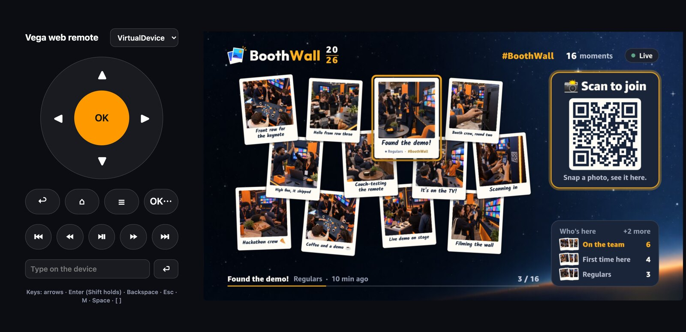

# vega-web-remote

A remote control for the Vega Virtual Device and Fire TV devices in developer mode, in your browser.

The Virtual Device's on-screen remote is small and has no media keys. Testing a TV app also means pressing the same buttons over and over. This gives you a full remote in a browser tab: D-pad, OK (tap or hold), Back, Home, Menu, the media keys and text entry, with keyboard shortcuts. It presses real keys on the device through Vega's developer-mode input injector, so your app sees exactly what a physical remote sends.

```sh
npx github:ddedic/vega-web-remote
```

Or clone it and run `npm start`.

Open http://localhost:4400, pick the device and press away.

 Needs the [Vega SDK](https://developer.amazon.com/docs/vega/) (the `vega` CLI, found in `~/vega/bin` or on your `PATH`) and Node 20 or later. No dependencies.

| Key | Button |
|---|---|
| Arrows | D-pad |
| Enter / Shift+Enter | OK / OK held (a long press) |
| Backspace | Back |
| Escape | Home |
| M | Menu |
| Space | Play/Pause |
| `[` / `]` | Previous / Next |

Media keys reach an app through Vega Media Controls, not through `useTVEventHandler`, so they're handy for testing a media session. A held OK arrives as repeated key-downs and one key-up, which is how to test long presses.

## Options

```
vega-web-remote [--port 4400] [--vega <path to the vega CLI>]
```

## How it works and what it allows

The page posts to a small server on `127.0.0.1`. The server runs `vega device run-cmd --device <name> --command 'inputd-cli button_press <KEY> short|long'` for you.
- Only the listed buttons and holds are accepted, and only for devices `vega device list` reports.
- Typed text is limited to letters, digits, spaces and `@._-`, up to 64 characters, because the device runs the command through a shell.
- The server never listens beyond localhost.

## Development

```sh
npm test
```

Built while making [BoothWall](https://github.com/ddedic/boothwall), a photo wall for Fire TV. MIT licensed.
